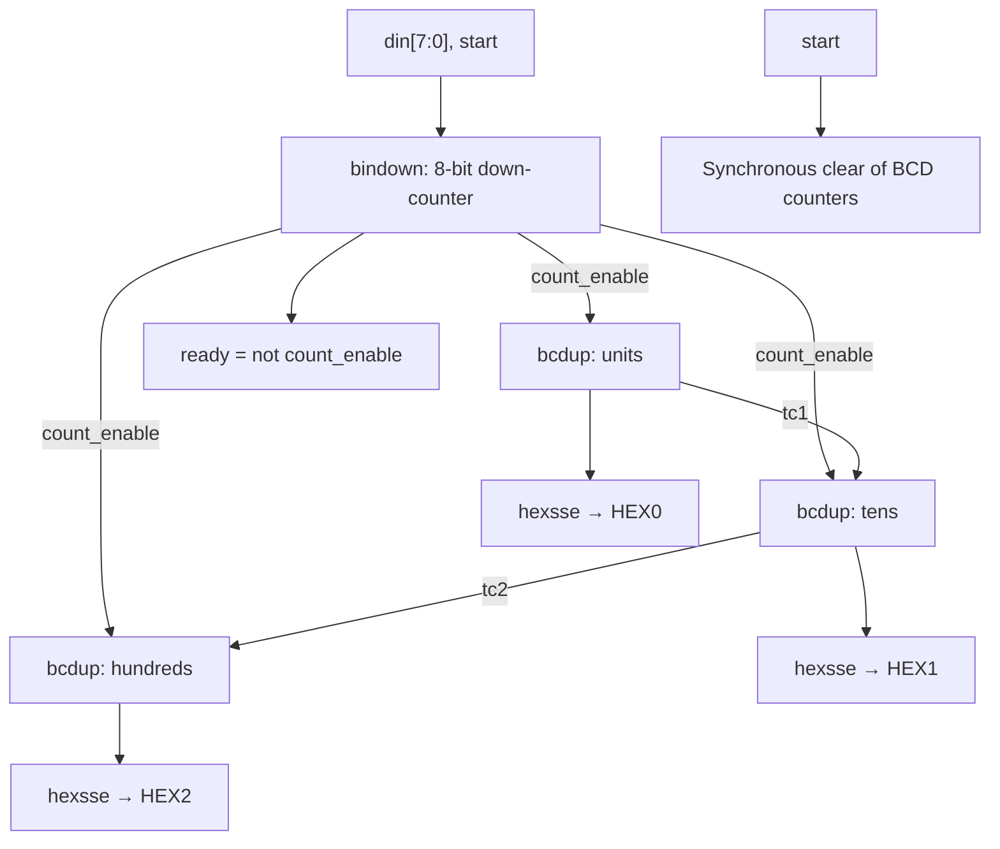

# Converter architecture and verification

## Block-level architecture

The datapath is counter-based rather than a Double Dabble implementation.
At the rising edge where `start=1`, the input loads and the BCD counters synchronously reset. Each following clock while the down-counter is nonzero decrements its value and advances the cascaded BCD counters.

## Verification

The new `tb/tb_bin2bcd_selfcheck.vhd` checks all 256 possible unsigned inputs against the seven-segment encoding of the expected decimal output. It also checks `ready` and a restart during conversion.

The legacy testbench in `tb/tb_bin2bcd.vhd` is preserved unchanged, but its output port names do not match the existing top-level entity.

**Evidence needed:** A simulation run, waveform capture and Quartus synthesis reports have not been supplied or generated. Add real results here only after running the tools. Do not interpret this documentation as a claim of successful synthesis or simulation.
